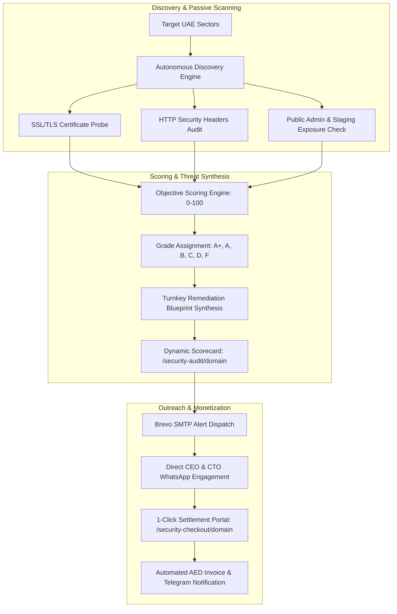

# 🛡️ OmniSecurity AI: Autonomous Corporate Cyber Hygiene & Web Security Hardening Shield

**OmniSecurity AI** is an autonomous B2B revenue and threat-defense agent. It continuously probes public corporate web assets across high-ticket UAE sectors, detects critical cryptographic and HTTP transport vulnerabilities, generates public interactive cyber hygiene scorecards, and pitches turnkey corporate hardening packages in UAE Dirhams (AED).

---

## 🏗️ Architecture & Operational Pipeline

---

## 💰 Monetization Packages (AED Accounting)

1. **Essential Cyber Hardening Package (AED 1,850.00)**
   - Strict HSTS Preload deployment
   - Content-Security-Policy (CSP) script injection defense
   - X-Frame-Options clickjacking mitigation
   - Server version disclosure & signature cloaking

2. **Enterprise Corporate Shield (AED 3,850.00)**
   - All Essential Hardening features
   - Cloudflare WAF Access Rule deployment
   - Administrative login gateway isolation
   - 90-Day continuous threat & SSL expiry monitoring

---

## 🚀 1-Click Deployment to Render Cloud

Deploy this agent 24/7 to Render using the official Blueprint:

1. Push this repository to your GitHub account (`LUTHERlast/omni-security-agent`).
2. Click **[Deploy on Render](https://render.com/deploy)**.
3. Enter your Brevo SMTP relay key in the `SMTP_PASSWORD` prompt:
   `your_brevo_smtp_key_here`
4. Click **Apply**.

---

## 🌐 Endpoints & Master Fleet Integration

* **Executive Dashboard**: `http://127.0.0.1:8787` (or cloud domain)
* **Public Audit Scorecard**: `/security-audit/{domain}`
* **Turnkey Settlement Portal**: `/security-checkout/{domain}`
* **Live Health & Telemetry**: `/api/health`
* **Fleet Portfolio Metrics**: `/api/stats`
